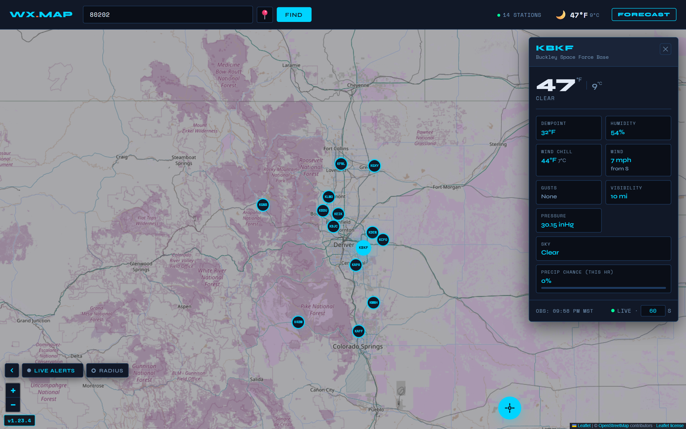
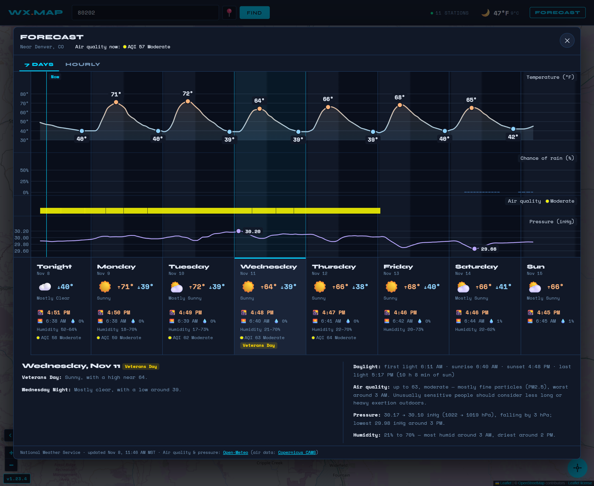
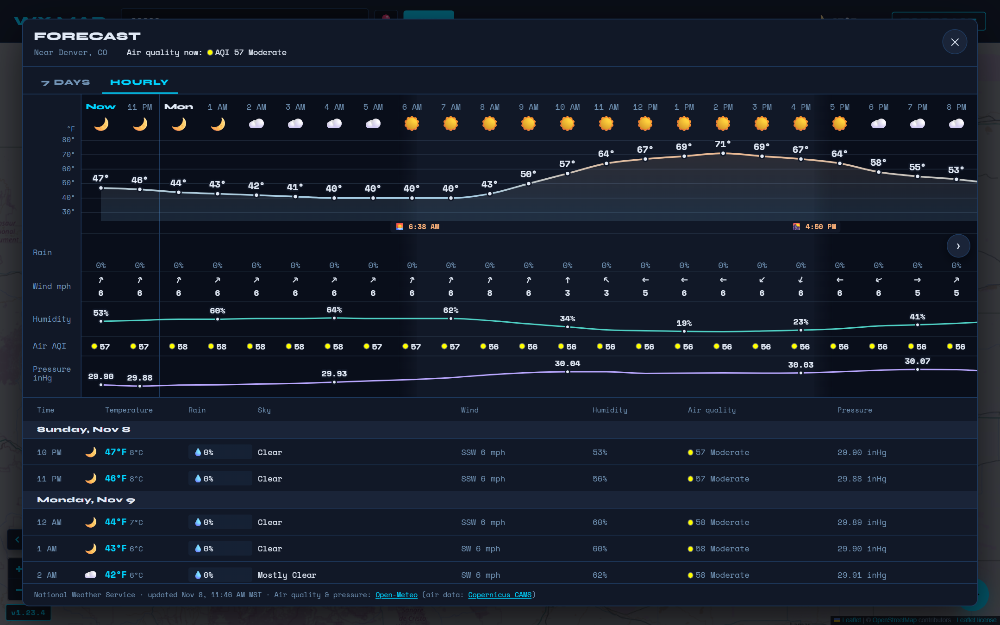
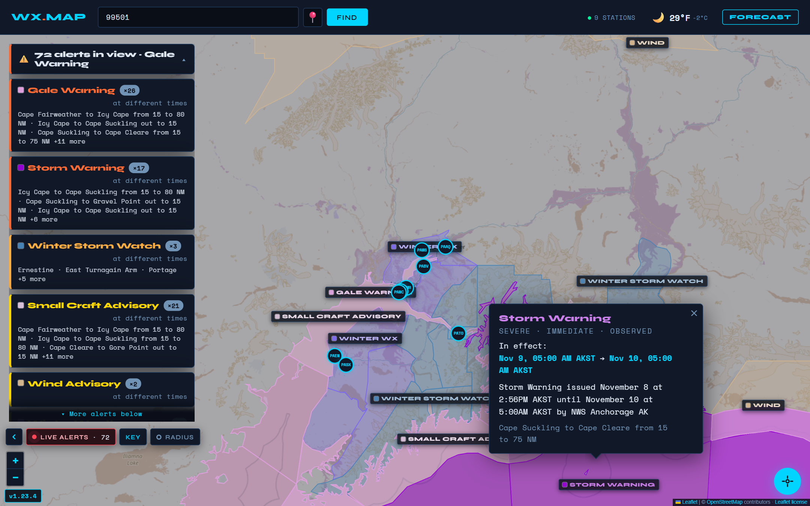
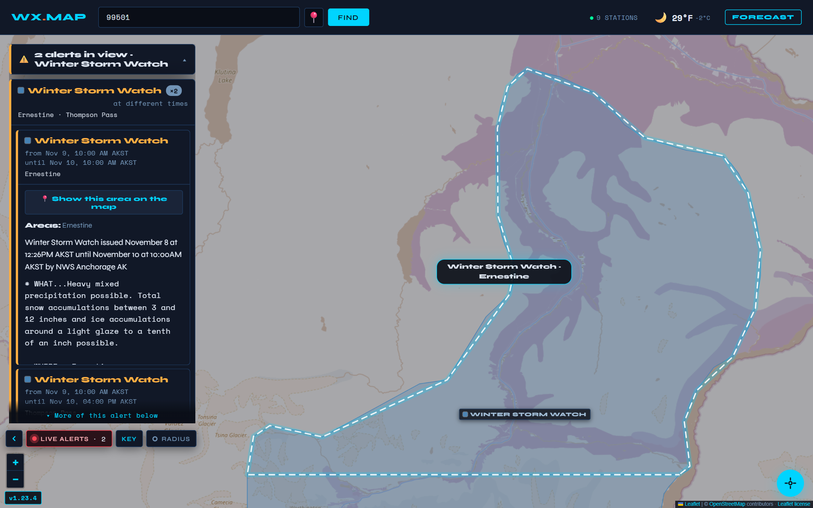
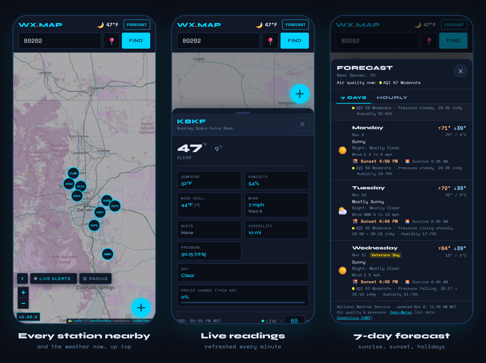

<div align="center">

# 🌦️ WX.MAP

### Live weather from the real stations around you — on one fast, free map.

Type a ZIP code or an address, drop a pin, or tap *Locate me*. WX.MAP finds every official NOAA weather station
nearby, shows what each one is measuring **right now**, and lays the week ahead out at a glance.

**No sign-up · No ads · No tracking · No API keys · Installs like an app**



</div>

## Why WX.MAP?

Most weather apps give you one number for your whole town — a blend from a forecast model, often wrapped in ads.
WX.MAP shows you the instruments themselves.

| | **WX.MAP** | Typical weather app |
|---|---|---|
| **Where the numbers come from** | Every official station near you — airports, weather offices — each with its own live readings | One estimate for your city |
| **Weather warnings** | Every National Weather Service watch, warning and advisory, drawn on the map — in the official colours with LIVE ALERTS on | Alerts as notifications, rarely on a map |
| **The week ahead** | One chart: temperature, rain, air quality and pressure, day and night, with sunrise and sunset | Seven icons and two numbers per day |
| **What it costs you** | Nothing: no account, no ads, no tracking, no keys | Often ads, sign-ups or premium tiers |

---

## ✨ Highlights

### 📍 Every station, live

Search by **ZIP code, street address** (with suggestions as you type), **coordinates**, a **dropped pin** or **your location**,
and the stations within about 50 miles appear on the map. Tap one for its readings — temperature (with the heat index
or wind chill when it matters), dew point, humidity, wind and gusts, pressure, visibility, sky cover and this hour's
chance of rain — **refreshed every minute** (or as often as you like) while you watch.
The header shows **the weather now** at your spot, from the nearest station that reports both the sky and the temperature.

### 🗓️ A week at a glance



The **FORECAST** button turns the National Weather Service forecast into one continuous chart —
temperature, rain, **air quality** and **pressure** on a single timeline, nights shaded from sunset to sunrise.
Point at any hour for the details; pick a day for the forecaster's own words.
Each day shows its **sunset and sunrise**, the heat index on hot, humid days, and **holidays** in gold.

### ⏱️ Hour by hour



The next 48 hours in one scrollable strip — sky, temperature, rain, wind, humidity, air quality and pressure —
with sunrise and sunset marked, and the full table below. The forecast opens on whichever view you used last.

### ⚠️ Warnings, the way forecasters draw them

<table>
<tr>
<td width="50%"></td>
<td width="50%"></td>
</tr>
<tr>
<td align="center"><b>Every alert in view</b>, in the official colours</td>
<td align="center"><b>Show one on the map</b>: a moving dashed outline</td>
</tr>
</table>

Active watches, warnings and advisories for your area appear in a **ranked banner** and as **outlined areas** on the map.
Turn on **LIVE ALERTS** and every alert in view is painted in the official NWS colours, updating as you pan and zoom;
tap one for how severe it is and when it's in effect. Open an alert in the list and press **Show this area on the map**:
the map flies there and traces the area with a **moving dashed line**. A station inside a warning gets a pulsing red ring.

### 📱 Made for your phone



Readings slide up in a **bottom sheet** you swipe away. Big tap targets, a one-tap **Locate me** button,
and header buttons that stay put while the weather loads beside them.
**Install it** to your home screen and it opens like an app — and still starts without a connection.

---

## 🧭 More good stuff

- **Share any view** — every search updates the link: `?zip=80202`, `?addr=…`, `?lat=…&long=…`, or `?station=KDEN` for one station.
- **Works everywhere the NWS does** — the lower 48, Alaska, Hawaii and US territories, even under the midnight sun.
- **Built for keyboard and screen readers** too — markers, charts and panels all work without a mouse.
- **Updates on your terms** — a new version never interrupts you; it waits until you tap **REFRESH NOW** or next open the app.
- **Simple and transparent** — the whole app is one HTML file, with the Leaflet map library beside it. No build step, no backend, no frameworks.

---

## 🚀 Run it

No install and no build. Serve the folder and open it:

```bash
python -m http.server 8080
```

Then visit **http://localhost:8080/index.html**. (Opening `index.html` directly works too, but *Locate me*, installing and offline use need `localhost` or HTTPS.)

Run the checks with `node --test`.

---

## 📖 The full guide

Every detail lives in **[docs/GUIDE.md](docs/GUIDE.md)**:
[search](docs/GUIDE.md#search-methods) ·
[station panel](docs/GUIDE.md#weather-station-popup) ·
[forecast](docs/GUIDE.md#forecast) ·
[alerts](docs/GUIDE.md#dangerous-weather-alerts) ·
[links](docs/GUIDE.md#url-query-parameters) ·
[install & offline](docs/GUIDE.md#progressive-web-app-pwa) ·
[how it's built](docs/GUIDE.md#architecture) ·
[browser support](docs/GUIDE.md#browser-compatibility)

## 🙏 Data & credits

All free, all key-less:
[NOAA / National Weather Service](https://www.weather.gov/) (stations, observations, forecasts, alerts) ·
[Open-Meteo](https://open-meteo.com/) with [Copernicus CAMS](https://atmosphere.copernicus.eu/) (air quality, pressure) ·
[Nominatim](https://nominatim.openstreetmap.org/) & [Photon](https://photon.komoot.io/) (address search) ·
[OpenStreetMap](https://www.openstreetmap.org/copyright) contributors (map) ·
[Leaflet](https://leafletjs.com/) ([license](LEAFLET-LICENSE.txt)).
